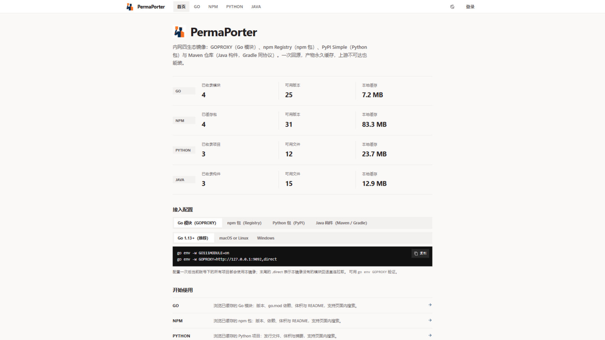
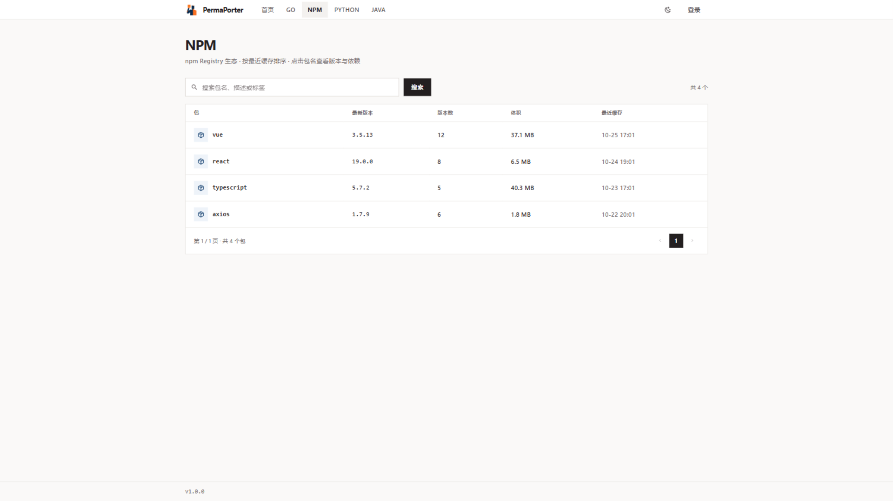
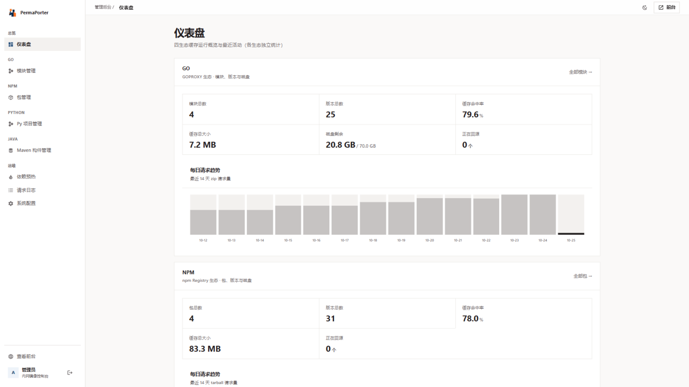
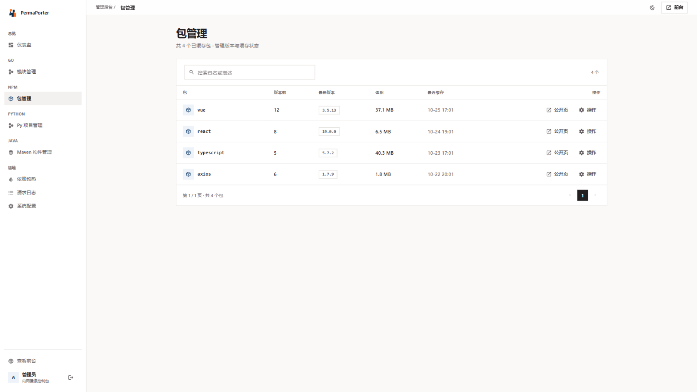
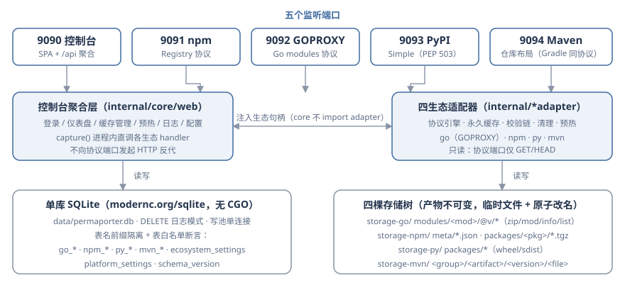

<p align="center">
  
</p>

<h1 align="center">PermaPorter</h1>

<p align="center">单二进制、五端口的内网只读包镜像：Go / npm / PyPI / Maven 四生态按需回源、产物永久缓存，断网也能完整构建。</p>

<p align="center">
  <a href="LICENSE">License: MIT</a> · Go 1.27+ · Vue 3
</p>

## 界面截图

| 主页 | 前台界面（NPM Registry） |
| :--- | :--- |
|  |  |
| **后台界面（仪表盘）** | **后台管理界面（包管理）** |
|  |  |

## 创建初衷

我最初的想法很简单：在本地做二次构建时不再依赖网络和上游镜像——包拉过一次就永久留在内网，断网也能把项目完整构建出来。趁着 ZCode 周末赠送额度，我用 GLM-5.3 与 GLM-5.3-Flash 写出了这个项目。项目完全基于我个人的使用习惯打造，只内置了我日常在用的四类生态（Go / npm / Python / Java-Maven），没有为没用过的语言添加镜像。这是一个简单的 Vibe 编程项目，欢迎 Fork 并修改成你想要的样子。

## 为什么叫 PermaPorter

**Perma**nent + **Porter**。Perma 指"产物永久缓存"——制品一旦拉取便永久落盘留存；Porter 意为"搬运工"——把上游的包搬运进本地；Port 同时呼应服务的五端口架构（一个控制台端口 + 四个协议端口）。

## 优势

- **单二进制零依赖**：纯 Go + 内嵌 SQLite（默认，无 CGO）+ go:embed 前端，交叉编译一条命令，部署即拷贝。
- **四生态合一**：Go / npm / PyPI / Maven 一个进程、一份配置搞定，无需分别部署四套代理。
- **永久缓存、离线可构建**：制品拉取一次永久留存，断网环境照样完整构建（这正是项目的初衷）。
- **完整校验链**：SRI / h1 / sha256 / sha1 逐层校验，缓存产物与上游一致。
- **只读安全**：协议端口仅 GET/HEAD，无认证面、无发布面。
- **开箱即用的管理台**：仪表盘、缓存管理、依赖预热、请求日志、上游与代理配置。

## 功能特性

- 五端口职责分离：9090 控制台与四个协议端口各自独立监听，互不混布。
- 按需回源、元数据 TTL 条件刷新（ETag/304），不可变产物落盘后不再回源。
- 四生态完整校验链（SRI / h1 / sha256 / sha1），任一环节失败不落盘。
- 依赖预热：粘贴 `go.mod` / `package.json` / `requirements.txt` / `pom.xml` 批量预拉取，单次上限 500 条。
- 请求日志：各生态最近 500 条代理请求（内存环形缓冲）。
- Prometheus 指标：9090 聚合 `go_permaporter_*` / `npm_permaporter_*` / `py_permaporter_*` / `mvn_permaporter_*` 四族指标。
- 单库（SQLite 默认 / PostgreSQL 可选，服务器配置文件 + 初始化向导切换）+ 四棵存储树：表名前缀与启动校验强制生态隔离。
- 四套独立清理器（启动 10 分钟后 + 每 12 小时 + 手动触发），30 分钟活跃保护窗口。

## 架构



| 端口 | 角色 | 说明 |
| :--- | :--- | :--- |
| 9090 | 控制台 | SPA 管理界面 + 聚合 API / healthz / metrics |
| 9091 | npm Registry | packument、tarball、audit 透传 |
| 9092 | GOPROXY | `@v/list`、`.info/.mod/.zip/.ziphash`、sumdb 透传 |
| 9093 | PyPI Simple | `/simple/` 锚点页 + `/packages/` 发行文件 |
| 9094 | Maven 仓库 | `maven-metadata.xml` + 构件文件（Gradle 同协议） |

## 快速开始

```bash
# 路径一：本地构建（需要 Go ≥ 1.27 与 pnpm；Windows 请在 Git Bash 中执行 make）
make release
INIT_PASSWORD=<管理员密码> UNATTENDED=1 ./dist/permaporter   # 默认监听 9090-9094（去掉 UNATTENDED 走初始化向导）

# 路径二：容器构建与运行
make docker-build VERSION=1.0.1
docker run -d -p 9090-9094:9090-9094 -v permaporter-data:/app/data permaporter:1.0.1

# 路径三：docker compose（SQLite 模式 / PostgreSQL 模式）
docker compose up -d                          # SQLite 模式（默认）
docker compose --profile postgres up -d       # PostgreSQL 模式（同时拉起 postgres 服务）
```

首次启动：浏览器打开 `http://<host>:9090` 完成初始化向导（选 SQLite / PostgreSQL、确认端口与上游源、设置管理密码，完成后全部端口就绪；也可直接编辑 `config/permaporter.toml` 配置后重启）。无头部署（CI/脚本）用 `UNATTENDED=1` + `INIT_PASSWORD` 自动初始化。

## 客户端接入

| 生态 | 配置 | 自检 |
| :--- | :--- | :--- |
| Go | `go env -w GOPROXY=http://<host>:9092,direct` | `go list -m -versions <已缓存模块>` |
| npm | `.npmrc` 写入 `registry=http://<host>:9091/` | `npm view <已缓存包>` |
| pip | `pip config set global.index-url http://<host>:9093/simple` | `pip download --no-deps -d /tmp <已缓存项目>` |
| Maven | `~/.m2/settings.xml` 配置 mirror（`mirrorOf=*`，`url=http://<host>:9094`） | `mvn dependency:get -Dartifact=junit:junit:4.13.2` |
| Gradle | `repositories { maven { url "http://<host>:9094" } }`（置于 mavenCentral 之前） | `gradle dependencies --refresh-dependencies` |

> 端口不要指反：各协议客户端只认自己的协议端口，指反只会得到 404。HTTP 内网源的信任主机等细节见 [docs/deploy.md](docs/deploy.md)。

## 技术栈

| 层 | 技术 |
| :--- | :--- |
| 后端 | Go 1.27 · Gin |
| 存储 | SQLite（默认，modernc.org/sqlite 纯 Go 无 CGO）/ PostgreSQL 可选（pgx），单库 + 四棵存储树 |
| 前端 | Vue 3 · Vite · TailwindCSS · pnpm（构建产物经 go:embed 嵌入二进制） |
| 容器 | 官方 alpine 基础镜像 + nginx 五 server 块反代（多阶段构建） |

## 文档导航

- [docs/architecture.md](docs/architecture.md) — 架构、五端口不变式、数据层、四套清理策略、并发模型、已知限制
- [docs/api.md](docs/api.md) — HTTP API 全表（协议端点 + 控制台 API）
- [docs/configuration.md](docs/configuration.md) — 环境变量全表与运行时配置
- [docs/deploy.md](docs/deploy.md) — 部署路径、可观测性、安全说明、备份与升级
- [docs/development.md](docs/development.md) — 开发环境、目录结构、代码组织约定
- [docs/single-db.md](docs/single-db.md) — 单库初始化、启动校验与重置
- [CHANGELOG.md](CHANGELOG.md) — 版本历史 · [AGENTS.md](AGENTS.md) — 自动化协作约束

## 已知限制

- 协议端点只服务已缓存对象，无（聚合）搜索端点；页面搜索仅覆盖本地已缓存数据。
- 缓存"只增不减"：产物永久缓存，清理任务只回收孤立文件/失效记录，磁盘水位由仪表盘监控。
- 元数据按 TTL 刷新；npm audit 透传依赖上游可达（不可用时 502）。
- 会话与命中率计数存于内存：重启后需重新登录，命中率重新累计（每日趋势已落库不受影响）。

## License

本项目基于 [MIT](LICENSE) 协议发布。
